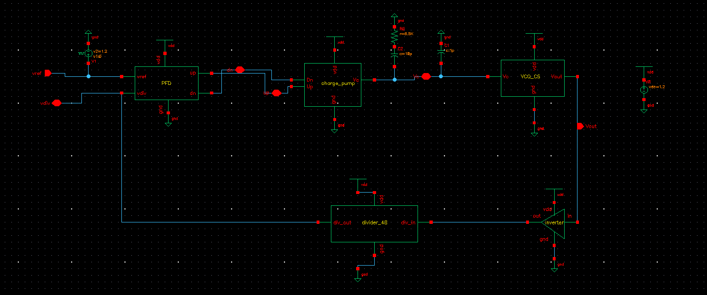

# 2.4 GHz Classical Charge-Pump PLL — GPDK 90nm

Designed and simulated in Cadence Virtuoso / Spectre, GPDK090 PDK.



## Core System Specifications

| Parameter | Value | Note |
|---|---|---|
| Technology | GPDK 90nm | 1.2 V supply (VDD) |
| Reference clock (F_ref) | 50 MHz | vpulse period = 20 ns |
| Output frequency (F_out) | 2.4 GHz | F_out = N × F_ref |
| Divider ratio (N) | 48 | TSPC-based counter |
| VCO type | Current-starved ring | High tuning range, compact layout |
| Closed-loop lock voltage (V_c) | ≈ 690 mV | — |
| Standalone VCO V_c for 2.4 GHz | ≈ 545–550 mV | mismatch vs. closed-loop, see below |
| K_VCO (low-Vc region) | ≈ 5.2 GHz/V | from V_c sweep, see [VCO doc](docs/05_vco_cs.md) |
| VCO jitter (RMS J_cc) | ≈ 69 fs | integrated 10 kHz–100 MHz |
| Loop filter | R2 = 8.5 kΩ, C2 = 10 pF, C1 = 1 pF | passive lag-lead, see [loop filter doc](docs/04_loop_filter.md) |
| Charge pump current (I_CP) | ≈ 100 µA | current-mirror based |

## Block Diagram & Signal Flow

`vref` (50 MHz reference) and `vdiv` (divider feedback) drive the **PFD**, which produces
`up`/`dn` correction pulses. These drive the **charge pump**, which sources/sinks `I_CP`
into the passive **loop filter** (R2, C2, C1) to produce the control voltage `Vc`. `Vc`
sets the free-running frequency of the **current-starved ring VCO**. The VCO output is
buffered (**inverter**) and fed to the **÷48 TSPC divider**, closing the loop as `vdiv`.

```
vref ─┐                                        ┌─> Vout ──> inverter ──> div_in
      ├─> PFD ─up/dn─> charge pump ─Vc─> loop  ─┤                              │
vdiv ─┘                              filter    └─> VCO_CS                      │
  ^                                                                            │
  └──────────────────────────── div_out <───────────── Divider_48 <───────────┘
```

Lock validation: `F_out = N × F_ref = 48 × 50 MHz = 2.4 GHz`, which matches the simulated
transient result ([waveform](images/07_transient_lock_waveform.png)) exactly — confirms
the divider and loop are functioning correctly end to end.

## Per-Block Documentation

| Block | Doc | Schematic |
|---|---|---|
| Top-level PLL | [01_top_level_architecture.md](docs/01_top_level_architecture.md) | `images/01_pll_top_level.png` |
| PFD | [02_pfd.md](docs/02_pfd.md) | `images/02_pfd.png` |
| Charge pump | [03_charge_pump.md](docs/03_charge_pump.md) | `images/03_charge_pump.png` |
| Loop filter | [04_loop_filter.md](docs/04_loop_filter.md) | (embedded in top-level schematic) |
| VCO (current-starved ring) | [05_vco_cs.md](docs/05_vco_cs.md) | `images/04_vco_cs.png`, `images/08_vco_kvco_sweep.png` |
| Inverter / buffer | [06_inverter_buffer.md](docs/06_inverter_buffer.md) | `images/05_inverter_buffer.png` |
| ÷48 Divider (TSPC) | [07_divider_48.md](docs/07_divider_48.md) | `images/06_divider48_tspc.png` |

## Key Observations

- **Capacitive-loading V_c shift.** The standalone VCO hits 2.4 GHz at V_c ≈ 545–550 mV,
  but the closed loop settles at V_c ≈ 690 mV for the same output frequency. The extra
  ~140 mV of control voltage is the loop compensating for the added gate capacitance of
  the output inverter buffer and the first TSPC divider stage, which the standalone VCO
  testbench doesn't see — more drive current is needed to swing that extra load at the
  same frequency, so the current-starved bias has to sit higher.
- **Nonlinear K_VCO.** The frequency-vs-V_c sweep is clearly compressive (concave), not
  linear — see [05_vco_cs.md](docs/05_vco_cs.md) for the segment-by-segment slope
  calculation (~5.2 GHz/V in the low-V_c region, dropping to ~2.9 GHz/V near the lock
  point). This matters for loop bandwidth/stability analysis since the effective loop
  gain changes across the tuning range.
- **Jitter.** Standalone ring VCO RMS cycle-to-cycle jitter is ≈ 69 fs, well under 1% of
  the 2.4 GHz period (≈ 417 ps), so it isn't expected to be the dominant timing-margin
  constraint for downstream digital logic.
- **TSPC for the divider.** Static CMOS DFFs were avoided in the feedback divider in
  favor of True Single-Phase Clock (TSPC) logic — fewer transistors per stage, no
  complementary clock routing, better suited to toggling reliably at multi-GHz rates.

## Simulation Methodology

- **Transient lock (startup).** Simulating a full 0 V→lock transient at 90 nm is
  expensive because of the slow charge-pump ramp. Applying an initial condition
  (`ic Vc=0.68`) on the loop-filter node skips the slow ramp and goes straight to
  capturing phase-settling and ripple dynamics — cuts simulation time from hours to
  minutes.
- **Autonomous VCO characterization (PSS/Pnoise).** The VCO_CS block was characterized
  standalone with a Periodic Steady State (PSS) analysis using the **Shooting** engine
  (better suited to the strongly nonlinear ring transitions than Harmonic Balance), 10
  harmonics. Phase noise / jitter was then extracted with a **pnoise** relative sweep
  (10 kHz–100 MHz): noise type `sources` for the spectral-density plot, noise type
  `jitter` for the direct time-domain RMS number.

## Repo Structure

```
Classical_PLL_repo/
├── README.md
├── docs/                  # per-block explanation + sizing
│   ├── 01_top_level_architecture.md
│   ├── 02_pfd.md
│   ├── 03_charge_pump.md
│   ├── 04_loop_filter.md
│   ├── 05_vco_cs.md
│   ├── 06_inverter_buffer.md
│   └── 07_divider_48.md
└── images/                # schematic screenshots + sim result plots
    ├── 01_pll_top_level.png
    ├── 02_pfd.png
    ├── 03_charge_pump.png
    ├── 04_vco_cs.png
    ├── 05_inverter_buffer.png
    ├── 06_divider48_tspc.png
    ├── 07_transient_lock_waveform.png
    └── 08_vco_kvco_sweep.png
```

> **Note on source files.** This repo currently holds documentation + exported images
> only. The actual Cadence library (`sch.oa`, OpenAccess binary) isn't portable outside
> Virtuoso/a licensed OA install, so it isn't included here — add raw netlists
> (`Design → Create Netlist` in ADE) separately if you want simulation-reproducible
> source alongside the docs.
