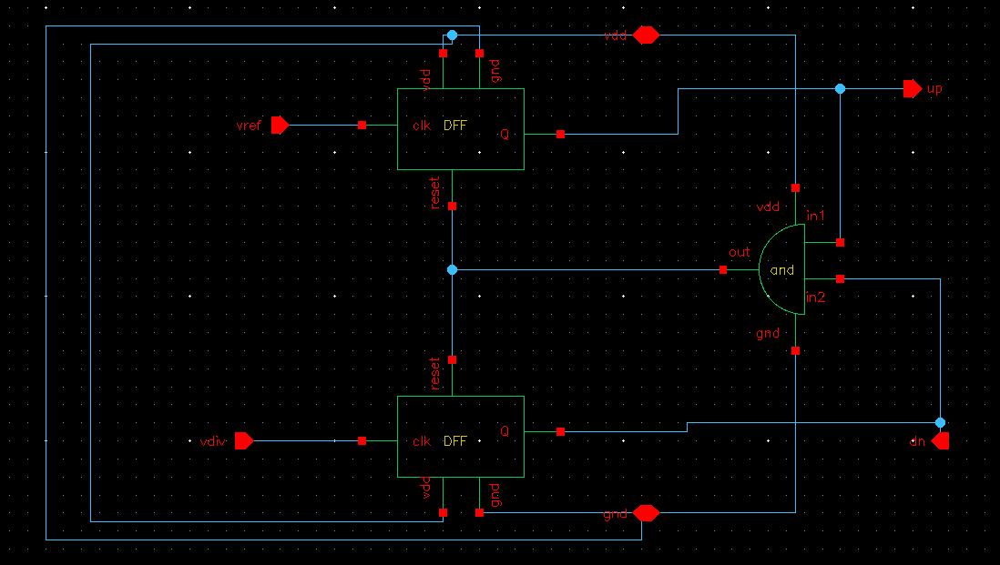

# PFD — Phase/Frequency Detector

## Topology

Standard two-DFF + AND-gate-reset PFD (the classic tri-state PFD realized at the
gate level):

- Two resettable D flip-flops, **D tied permanently to VDD** (logic 1).
- Top FF clocked by `vref` → `Q` drives `up`.
- Bottom FF clocked by `vdiv` → `Q` drives `dn`.
- Both `Q` outputs feed a 2-input **AND** gate; the AND output drives the `reset` pin
  of *both* flip-flops simultaneously.

## Working

1. On a rising edge of `vref`, the top FF sets `up = 1`.
2. On a rising edge of `vdiv`, the bottom FF sets `dn = 1`.
3. The moment *both* `up` and `dn` are simultaneously high, the AND gate's output goes
   high and resets both flip-flops back to 0.
4. Net effect: whichever edge (vref or vdiv) arrives first gets a pulse on its output
   whose width equals the time difference between the two edges; the later edge's
   output is reset almost immediately after it appears. The simultaneous-high condition
   never persists — this is the standard dead-zone-avoidance reset mechanism (the AND
   gate, not an OR, is what prevents the short "glitch" pulse from being missed by the
   charge pump near zero phase error).

So `up` pulses when `vref` leads `vdiv` (VCO running slow → need to source more current
→ speed up), and `dn` pulses when `vdiv` leads `vref` (VCO running fast → sink current →
slow down). Pulse width is proportional to instantaneous phase error; during an initial
frequency error (not just phase), `up`/`dn` stay asymmetric in duty cycle until the loop
pulls into frequency lock, after which both collapse toward very narrow pulses governed
only by charge-pump dead time / reset-loop delay.

## Notes for the writeup

- This is a sequential (edge-triggered), not combinational (XOR-based), PFD — it has a
  full ±2π linear detection range rather than the ±π range of an XOR detector, which is
  why it's the standard choice for CP-PLLs that need to acquire lock from an arbitrary
  frequency offset, not just track small phase error.
- The reset path (FF `Q` → AND → both FFs' `reset`) introduces a finite reset delay
  (AND gate + FF reset propagation). This sets a minimum `up`/`dn` pulse width even at
  perfect lock, which is what you're seeing as the narrow non-zero pulses on `up`/`dn`
  in the transient plot at steady state rather than them going to exactly zero width.
