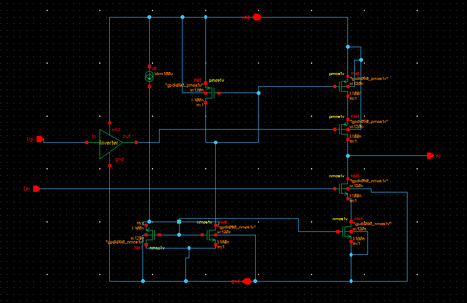

# Charge Pump

## Topology

Current-mirror-based, dual-switch charge pump:

- A reference current source `Iq = 100 µA` feeds a diode-connected PMOS (**PM2**),
  setting the `vbp`-style bias node for the pull-up (sourcing) leg.
- A diode-connected NMOS stack (**NM1 + NM3** in series) on the ground side mirrors
  that same reference current, setting the bias for the pull-down (sinking) leg.
- The **pull-up leg** (PM0 + PM1, series-stacked PMOS) mirrors `Iq` from VDD into the
  output node when enabled.
- The **pull-down leg** (NM4 + NM8, series-stacked NMOS) mirrors `Iq` to GND from the
  output node when enabled.
- `Up` from the PFD is first passed through a local **inverter** before reaching the
  pull-up leg's switch gate (PMOS needs an active-low enable); `Dn` drives the
  pull-down leg's switch gate directly (NMOS is active-high).
- Output node is `Vc` (same as `Vo` from the top-level schematic) — directly the
  loop-filter input.

## Sizing

| Device | Type | W | L | m | Role |
|---|---|---|---|---|---|
| PM2 | pmos1v | 120 nm | 100 nm | 1 | Diode-connected mirror reference (pull-up bias) |
| PM0 | pmos1v | 120 nm | 100 nm | 1 | Pull-up mirror/output device |
| PM1 | pmos1v | 120 nm | 100 nm | 1 | Pull-up switch (gate = inverted Up) |
| NM1 | nmos1v | 120 nm | 100 nm | 1 | Diode-connected mirror reference (pull-down bias) |
| NM3 | nmos1v | 120 nm | 100 nm | 1 | Diode-connected mirror reference (series with NM1) |
| NM4 | nmos1v | 120 nm | 100 nm | 1 | Pull-down mirror/output device |
| NM8 | nmos1v | 120 nm | 100 nm | 1 | Pull-down switch (gate = Dn, direct) |

All charge-pump devices sit at minimum/near-minimum length (L = 100 nm) with matched
W = 120 nm, m = 1 — a straightforward 1:1 current mirror. **Double-check the exact
PM0/PM1 and NM4/NM8 series order against the schematic before publishing** — the W/L
labels are unambiguous but which of the pair sits directly at the switch vs. directly
at the mirror-diode side is easy to mis-read off a flattened screenshot at this zoom
level, and it matters for the cascode-vs-plain-switch distinction below.

## Working

$$ I_{CP} \approx I_q = 100\,\mu A \quad \text{(nominal, 1:1 mirror)} $$

- `Up` active → inverted → PM1 gate low → pull-up leg sources ≈ 100 µA into `Vc`.
- `Dn` active → NM8 gate high → pull-down leg sinks ≈ 100 µA from `Vc`.
- Net current into the loop filter integrates to the control voltage change per PFD
  cycle: $$ \Delta V_c = \frac{I_{CP} \cdot t_{pulse}}{C_{loop}} $$ where `t_pulse` is
  the up/dn pulse width from the PFD and `C_loop` is the loop-filter capacitance seen
  at that instant (dominated by C2, see [loop filter doc](04_loop_filter.md)).

## Non-idealities worth flagging in the writeup

- **Mirror mismatch (charge-pump current mismatch).** The pull-up and pull-down legs
  are each a two-transistor series stack with different V_DS at the output node
  depending on where `Vc` currently sits — classic CP-PLL non-ideality. Even with
  identical W/L, up-current and down-current won't match exactly across the full
  `Vc` swing, which shows up as reference spurs. Worth a quick DC sweep of
  `I_up(Vc)` vs. `I_down(Vc)` across the expected lock range (≈ 0.5–0.9 V here) for
  the writeup if mismatch hasn't been characterized yet.
- **Switch feedthrough / charge injection** at the PM1/NM8 switching nodes contributes
  to the ripple visible on `Vc` in the transient plot, on top of the expected
  charge/discharge ramp.
