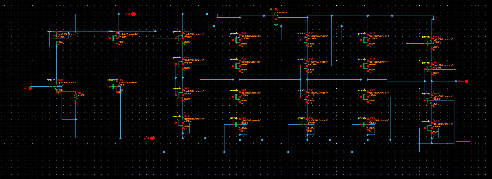
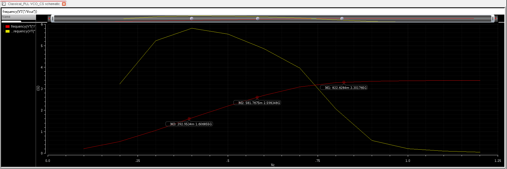

# VCO_CS — Current-Starved Ring Oscillator

## Topology

Classic current-starved ring VCO with a source-degenerated V-I front end:

- **V-I converter**: `Vc` drives the gate of **NM21** (w = 160 nm, l = 100 nm), with
  **R6 = 15 kΩ** as source degeneration to ground. This converts the control voltage
  into a reference bias current, with the resistor giving some linearization of the
  V→I transfer compared to a bare diode-connected device.
- That reference current is mirrored (via a diode-connected PMOS/NMOS bias pair,
  ~180 nm devices) into `vbp`/`vbn` bias rails that are distributed to every ring
  stage.
- Each ring stage is a **current-starved CMOS inverter**: a PMOS pull-up pair in series
  (one biased by `vbp` to limit current, one acting as the actual switching device) and
  an NMOS pull-down pair in series (switching device + `vbn`-limited device), with
  stage sizes in the 120–240 nm range (switching devices sized larger, ≈ 240 nm, than
  the per-stage starving devices, ≈ 150 nm, to keep edge rates reasonable once current
  is reduced).
- Odd number of inverting stages, chained ring-fashion, output taken from the last
  stage as `Vout`.

**Flag for the writeup:** the exact stage count and the precise per-transistor
role (which of each series pair is the switch vs. the current-limiter) should be
confirmed directly against the schematic in Virtuoso before finalizing the doc —
reading it off a flattened multi-stage screenshot reliably gets the general topology
and the W/L values, but not with 100% confidence on which reference designator is
which role stage-by-stage.

## K_VCO — derived from the sweep data

The sweep (`frequency(VT("/Vout"))` vs. `Vc`) gives three clearly marked points on the
usable (red) curve:

| Marker | V_c | Freq |
|---|---|---|
| M3 | 392.95 mV | 1.6069 GHz |
| M2 | 581.77 mV | 2.5983 GHz |
| M1 | 822.63 mV | 3.3018 GHz |

Segment slopes:

$$ K_{VCO,\,M3\to M2} = \frac{2.598 - 1.607}{0.5818 - 0.3930}\,\text{GHz/V}
\approx 5.24\,\text{GHz/V} $$

$$ K_{VCO,\,M2\to M1} = \frac{3.302 - 2.598}{0.8226 - 0.5818}\,\text{GHz/V}
\approx 2.92\,\text{GHz/V} $$

This confirms your ≈ 5.23 GHz/V estimate — but only for the *low-V_c* region of the
curve. **K_VCO is clearly nonlinear (compressive)**, dropping to roughly half that
slope by the time you're near the 690 mV closed-loop lock point, and the curve is
visibly flattening further above ~900 mV. This matters directly for loop-bandwidth
calculations (see [loop filter doc](04_loop_filter.md)) — using the low-V_c slope for
a bandwidth estimate near the actual lock point will overstate loop gain.

The second (yellow) trace on the same plot rises faster and peaks near 6 GHz before
dropping off — worth adding a one-line caption in the actual repo clarifying what this
second trace represents (different corner? pre-buffer node? different measurement
method?), since it isn't otherwise labeled in the plot and will be ambiguous to anyone
reading the repo without that context.

## Standalone vs. closed-loop mismatch

Standalone (unloaded) VCO hits 2.4 GHz at `Vc ≈ 545–550 mV`. In the closed loop, lock
settles at `Vc ≈ 690 mV` for the same 2.4 GHz output. The ~140 mV gap is the loop
compensating for extra capacitive load the standalone testbench doesn't present — the
output inverter buffer's input gate cap plus the first TSPC divider stage's input cap,
both only present once the VCO is wired into the full PLL. More load capacitance at a
fixed frequency needs more charging current, so the current-starved bias (set by `Vc`)
has to sit higher to deliver it. Confirms the earlier closed-loop saturation issue
(previously logged around 2.5 GHz) has been resolved by whatever sizing change moved the
standalone operating point down to ~545–550 mV in this version.

## Jitter

RMS cycle-to-cycle jitter (J_cc), integrated 10 kHz–100 MHz via pnoise: **≈ 69 fs**.
Against a 2.4 GHz period (≈ 417 ps), that's ≈ 0.017% of the period — not expected to be
a binding constraint on downstream digital timing margins at this divide ratio.
