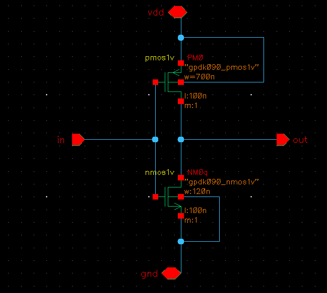

# Inverter — VCO-to-Divider Buffer

## Topology

Single CMOS inverter, sitting between `VCO_CS`'s `Vout` and the `Divider_48` block's
`div_in` (see top-level schematic) — re-shapes/buffers the ring-oscillator output
before it drives the divider's first TSPC stage.

## Sizing

| Device | Type | W | L | m |
|---|---|---|---|---|
| PM0 | pmos1v | 700 nm | 100 nm | 1 |
| NM0 | nmos1v | 120 nm | 100 nm | 1 |

$$ \frac{W_p}{W_n} = \frac{700}{120} \approx 5.8 $$

## Working / sizing rationale

A standard balanced inverter in this node would use something closer to a 2–3×
PMOS/NMOS width ratio to compensate for the electron/hole mobility difference and
equalize rise/fall time. A 5.8× ratio is noticeably more skewed than that, which
points to one (or both) of:

- **Drive strength**: the VCO output has limited drive (current-starved stages are
  deliberately current-limited), so this buffer may be oversized on the PMOS side
  specifically to restore fast, full-swing logic levels into the divider without
  loading the VCO itself down — sizing the buffer input appropriately small while
  making the output stage strong.
- **Duty-cycle correction**: current-starved ring VCOs often have asymmetric rise/fall
  at the output tap (PMOS and NMOS starving currents aren't perfectly matched across
  the ring), and a skewed buffer ratio like this is a common way to pull the duty cycle
  back toward 50% before it reaches the divider, since the TSPC divide chain's timing
  margins can depend on reasonably clean duty cycle.

Worth confirming which of these was the actual design intent (or if it was sized this
way through PVT-corner iteration on the divider's minimum/maximum pulse-width
requirement) so the repo doc states the real reason rather than just the plausible one.
