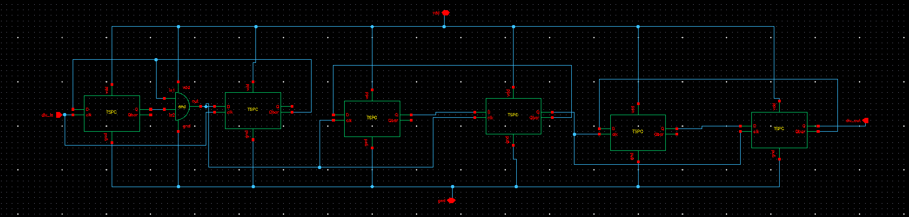

# Divider_48 — ÷48 Feedback Divider (TSPC)

## Topology

A chain of **True Single-Phase Clock (TSPC)** D flip-flops (six TSPC blocks visible),
with a combinational **AND** gate feeding back into the first stage, taking `div_in`
from the buffered VCO output and producing `div_out` back to the PFD as `vdiv`.

TSPC is the standard choice here over static CMOS master-slave DFFs because:

- Fewer transistors per latch (no need for separate clock and clock-bar distribution —
  single-phase clocking, hence the name).
- No complementary-clock routing/skew to manage, which matters more and more as you
  approach the 2.4 GHz toggle rate at the first divider stage.
- Lower clock-load capacitance per stage, which is exactly the load this chain presents
  back to the [inverter buffer](06_inverter_buffer.md) driving `div_in`.

## Factorization

$$ 48 = 3 \times 16 = 3 \times 2^4 $$

The AND-gate feedback near the first TSPC stage is consistent with a non-power-of-two
**÷3 prescaler** (a TSPC flip-flop plus combinational feedback is a standard way to
build a modulus-3 counter, since a pure binary toggle chain can only ever give you
powers of two), followed by binary ÷2 toggle stages to complete ÷16, giving the overall
÷48.

**Flag for the writeup:** the exact state sequence / which specific TSPC stages
form the ÷3 prescaler vs. the ÷16 chain should be verified against the schematic
directly (ideally with a quick testbench: clock the divider standalone and count
`div_out` edges per `div_in` edge over a few cycles) before stating the breakdown as
fact in the final repo doc — six stages for a 3×16 factorization is plausible but the
internal connectivity isn't fully resolvable from a single flattened screenshot.

## Validation

Already indirectly confirmed by the closed-loop lock: with `F_ref = 50 MHz` and the
loop locking at exactly `F_out = 2.4 GHz`, `F_out / F_ref = 48`, matching the intended
divide ratio — the strongest available evidence the divider's modulus is correct, even
without a fully traced internal state diagram.
